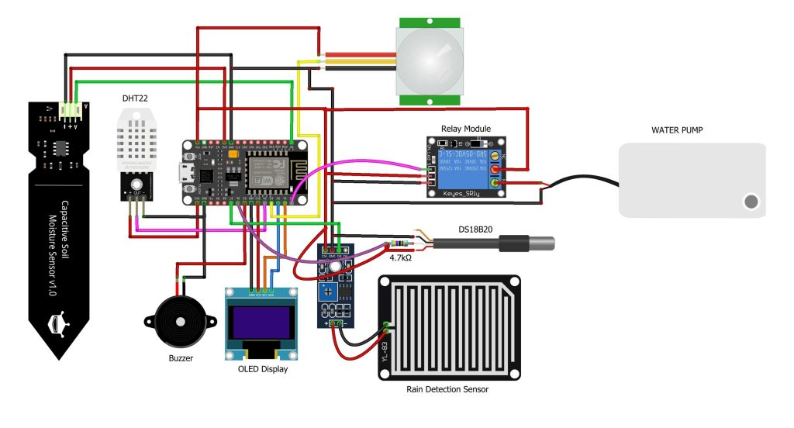

# IoT Smart Irrigation and Field Monitor (NodeMCU)

A NodeMCU (ESP8266) system that waters a plant bed automatically when the soil is dry, monitors the field's conditions, and uploads the data to ThingSpeak for remote viewing.

## Features

- **Automatic irrigation:** a capacitive soil-moisture sensor drives a relay and water pump. Watering starts at 30% soil moisture or below and stops at 45% or above (hysteresis, so the pump does not flicker on and off).
- **Pump safety:**
  - maximum run time of 60 seconds per cycle, then a 10-minute cooldown
  - blocked or stopped when the rain sensor detects rain
  - stays off if the soil sensor reading is invalid (for example, a disconnected sensor)
- **Field monitoring:** air temperature and humidity (DHT), soil temperature (DS18B20) and rain status.
- **Local display:** live values on a 128x64 SSD1306 OLED.
- **Remote monitoring:** data uploaded to ThingSpeak every 20 seconds.
- **Motion alert:** a PIR sensor sounds a buzzer when something moves near the field.
- **Works offline:** irrigation keeps running if Wi-Fi is lost; the board reconnects automatically.

## Hardware

- NodeMCU ESP8266
- Capacitive soil-moisture sensor
- DHT22 (set `DHTTYPE` to `DHT11` in the code if you use that)
- DS18B20 waterproof probe with a 4.7 kΩ pull-up resistor
- Rain sensor module
- PIR motion sensor
- Relay module and a water pump (use a separate power supply for the pump)
- SSD1306 OLED display (I2C)
- Buzzer

The circuit diagram above shows the components. For the wiring, use the pin table below, which matches the firmware.

| Component | NodeMCU pin |
|---|---|
| Soil-moisture sensor (analog) | A0 |
| DHT data | D5 |
| DS18B20 data | D6 |
| Relay input | D7 |
| Rain sensor (digital out) | D0 |
| PIR output | D8 |
| Buzzer | D3 |
| OLED SDA / SCL | D2 / D1 |

## Software

- Arduino IDE with the ESP8266 board package
- Libraries: `ThingSpeak`, `DHT sensor library` (Adafruit) with `Adafruit Unified Sensor`, `OneWire`, `DallasTemperature`, `Adafruit GFX Library`, `Adafruit SSD1306`

## Setup

1. Create a ThingSpeak channel with these 7 fields:

   | Field | Value |
   |---|---|
   | 1 | Soil moisture (%; -1 means sensor fault) |
   | 2 | Air temperature (°C) |
   | 3 | Air humidity (%) |
   | 4 | Soil temperature (°C) |
   | 5 | Pump state (1 = on) |
   | 6 | Rain (1 = raining) |
   | 7 | Motion events |

2. In `firmware/smart_irrigation/`, copy `secrets.example.h` to `secrets.h` and fill in your Wi-Fi name, Wi-Fi password, ThingSpeak channel ID and write key. `secrets.h` is ignored by Git and must never be committed.
3. Calibrate the soil sensor: read the raw value in dry air and in a glass of water, then set `SOIL_DRY_RAW` and `SOIL_WET_RAW` at the top of the sketch.
4. Check the pins, the relay polarity (`RELAY_ACTIVE_HIGH`) and the rain-sensor polarity (`RAIN_ACTIVE_LOW`) against your hardware.
5. Open `firmware/smart_irrigation/smart_irrigation.ino`, select your NodeMCU board, and upload.

## How the
